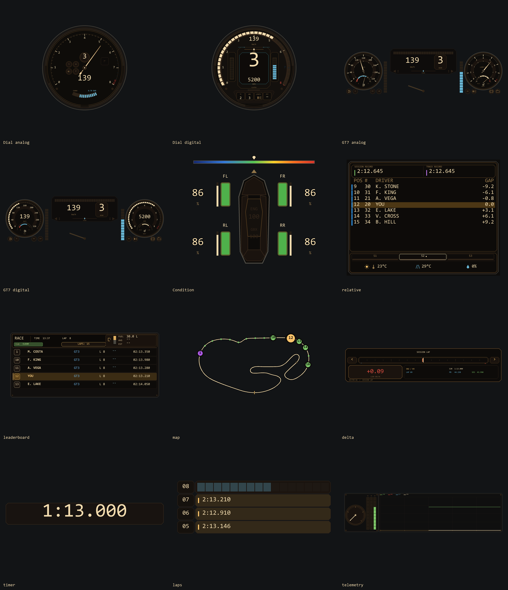
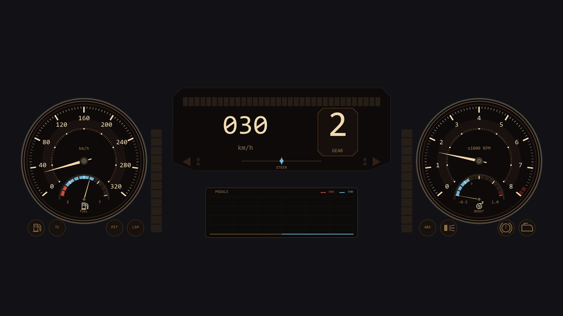
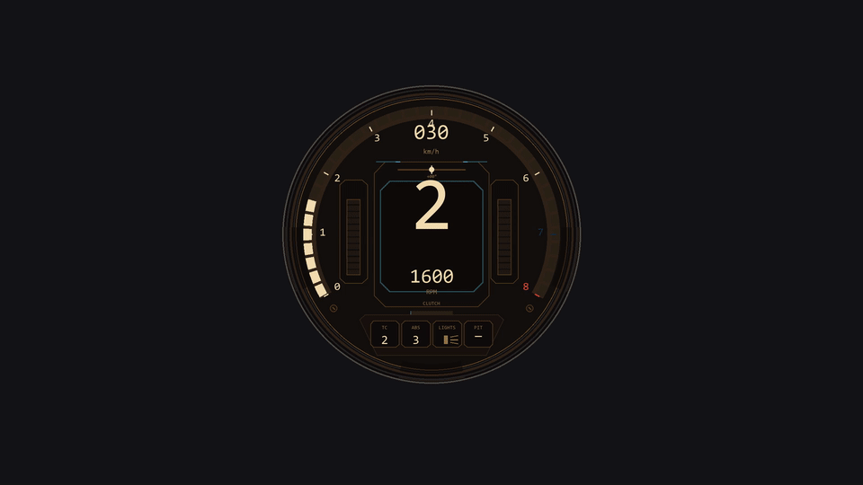
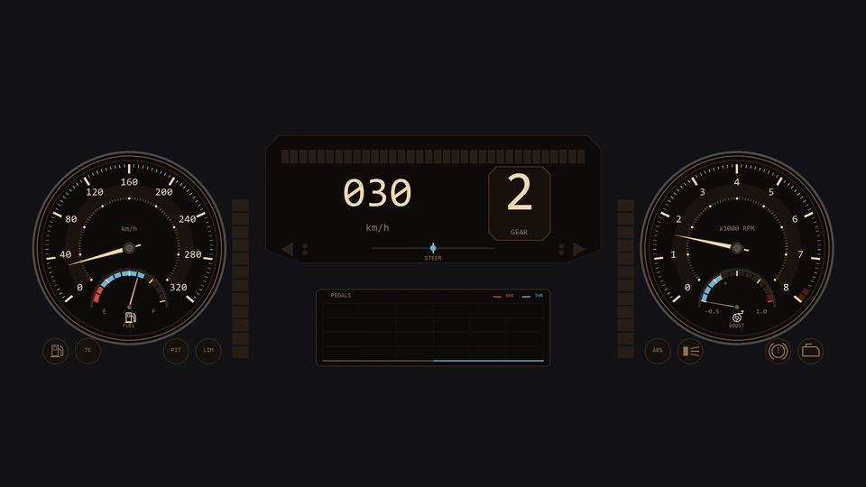

# Retro UI

Retro instruments for **Assetto Corsa + Custom Shaders Patch**. Eleven independent HUD windows, one app, shared appearance settings.

**Free, open source, and complete.** Every layout, editor and animation is included. Optional donations support development and never unlock features.

[Download the latest release](https://github.com/yukkine0704/assetto-corsa-retro-engineering-hud/releases/latest) · [User guide](docs/user-guide.md) · [Settings](docs/settings.md) · [Changelog](CHANGELOG.md) · [Report a bug](https://github.com/yukkine0704/assetto-corsa-retro-engineering-hud/issues)



## Instruments

| Window | What it shows |
| --- | --- |
| Dial | Analog/digital speed and RPM; Original plus four analog and five digital variants; fuel, turbo or hybrid power, pedals, TC/ABS and lights |
| GT7 | Configurable central display and side dials; Classic, Modern, Outer Pedals and Steering Dial presets |
| Car Condition | Tyre life, pressures, temperatures, grip references, stint and vehicle condition |
| Multiclass Relative | Nearby cars on track, classes, relative gaps, sectors and personal records |
| Leaderboard | Session classification, practice/qualifying sectors, race intervals, position changes and fuel summary |
| Delta Bar | Live lap comparison, sector references and local records |
| Timer | Lap timing, completed-lap results, final-lap indication and optional audio |
| Laps | Current progress and completed-lap history with optional transitions |
| Telemetry | Input traces, FFB and driving telemetry |
| Map | Full circuit or car-centred mini map, numbered markers and flag alerts |
| Battle Panel | Class rivals ahead and behind, signed time gained/lost per lap and enlarged history graphs |
| Race Notices | Blue flags with approaching class, repair warnings and automatic fuel-autonomy pit reminders with estimated repair time and rear battle warnings |

Open only the windows you need. Each window can be resized and anchored independently. Light/dark themes, units and opacity are shared through **Retro UI Settings**.

## Install

1. Use Assetto Corsa for PC with CSP Lua apps enabled. CSP **0.2.8 or newer** is recommended for the complete window anchoring and mouse pass-through behaviour.
2. Download **`RetroUI-vX.Y.Z.zip`** from Releases and drag it into Content Manager.
3. Enable **Retro UI**, start a session, then open its instruments and **Retro UI Settings** from the CSP app sidebar.
4. Right-click a HUD window to anchor or release it.

For manual installation, updates, previous installations and troubleshooting, see the [user guide](docs/user-guide.md). Updating keeps the `apps/lua/RetroUI` identity and existing stored settings. Earlier releases used separate package names; from 2.5.1 there is one complete download.

## UI videos

These previews run the actual Lua renderers with simulated telemetry. They demonstrate the UI; they are not recorded driving sessions. MP4 videos are eight seconds, 1080p/60 FPS and silent.

### GT7 and standalone Dial



[Watch GT7 analog](promo/videos/gt7_analog.mp4) · [Digital](promo/videos/gt7_digital.mp4) · [Modern](promo/videos/gt7_modern.mp4) · [Outer Pedals](promo/videos/gt7_outer_pedals.mp4) · [Steering Dial](promo/videos/gt7_steering_dial.mp4)



[Watch Dial digital](promo/videos/dial_digital.mp4) · [Analog](promo/videos/dial_analog.mp4) · [Analog/digital transition](promo/videos/analog_digital_transition.mp4)

### Radar, flags and map



[Watch radar and flags](promo/videos/controls_radar_flags.mp4) · [Map](promo/videos/map.mp4) · [Off-track markers](promo/videos/map_offtrack.mp4)

### Timing, condition and telemetry

[Relative](promo/videos/relative.mp4) · [Leaderboard](promo/videos/leaderboard.mp4) · [Delta](promo/videos/delta.mp4) · [Timer](promo/videos/timer.mp4) · [Laps](promo/videos/laps.mp4) · [Car Condition](promo/videos/condition_temperature.mp4) · [Telemetry](promo/videos/telemetry.mp4)

The [full video gallery](docs/media.md) includes lighting, hybrid recovery, fuel movement, aero and all 38 UI clips.

## Timing and data limitations

- Leaderboard intervals prefer CSP crossing timestamps, then continuous position history. Distance/speed estimates are marked **`~`**. Online finish crossings compensate for a rival lap counter stuck at zero.
- Relative orders nearby cars by physical track proximity. A lapping car approaching from behind remains behind in that display.
- Unknown sector validity stays neutral. Invalid laps do not improve sector records.
- Tyre references and stint history depend on the car's available data. **`~`** and **FROM OBSERVATION** identify estimates or incomplete history.
- Replay seeks rebuild history; some telemetry is unavailable in replays. Simulated turbo vacuum is an optional estimate.

The author confirmed driving validation throughout the release week and successful updates with previous releases. Version 2.5.1 additionally passes the automated regression suites, including independent ABS/TC readouts and leaderboard timing.

## Support and donations

Please include your CSP version, car/track, session type, steps to reproduce and a screenshot or clip when [reporting a bug](https://github.com/yukkine0704/assetto-corsa-retro-engineering-hud/issues).

Retro UI remains free with all features included. Donations are optional and support development.

[](https://ko-fi.com/R6R0MLVVS)

You can also [donate through PayPal](https://paypal.me/WendyGalvezSanchez).

## Development

See [development and release instructions](docs/development.md). CI checks Lua syntax and CSP callbacks, runs the full regression suite, and verifies the release ZIP and checksum. Version tags prepare a draft release.

```powershell
npm ci
python -m pip install -r requirements-dev.txt
npm run check:lua
python tools/test-lua.py
powershell -ExecutionPolicy Bypass -File tools/build-package.ps1
python tools/check-package.py dist/RetroUI-v2.5.1.zip
```

## License

[MIT](LICENSE). See [third-party notices](THIRD_PARTY_NOTICES.md). UI concepts and promotional media stay out of the game installation package.
